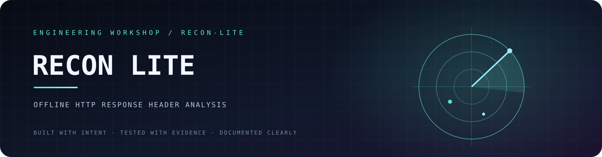
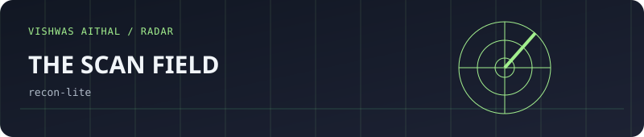
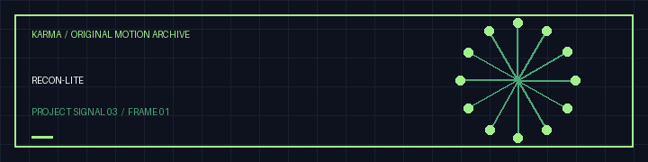

<!-- VISHWAS.EXE UNIFIED THEME START -->
<p align="center"><a href="https://recon-lite.vercel.app"></a></p>

<p align="center"><a href="https://vishwasaithalz.github.io/vishwasaithalz/">Personal index</a> &nbsp;·&nbsp; <a href="https://github.com/vishwasaithalz?tab=repositories">All projects</a> &nbsp;·&nbsp; <a href="https://vishwasaithal.ai.studio/">Portfolio</a></p>
<!-- VISHWAS.EXE UNIFIED THEME END -->

<details>
<summary>Earlier artwork and navigation</summary>

<p align="center"><a href="https://recon-lite.vercel.app"></a></p>
<p align="center"><strong>🔎 Recon Lite</strong> · HTTP response and security-header analysis</p>
<details>
<summary>Build and technology badges</summary>

<p align="center">
<a href="https://vishwasaithalz.github.io/vishwasaithalz/arcade/#terminal"></a>
<a href="https://vishwasaithalz.github.io/vishwasaithalz/arcade/#snake"></a>
</p>

<details><summary>🎨 Open original full-size project artwork</summary>
<p align="center"></p>
</details>

</details>

<p align="center">
  <a href="https://github.com/vishwasaithalz/recon-lite/actions/workflows/tests.yml"></a>
  
  
  
</p>
</details>

<p align="center"><strong>A focused offline review of saved HTTP response headers.</strong></p>

<p align="center"><a href="#-what-it-checks">Features</a> · <a href="#-quick-start">Quick start</a> · <a href="#-example-input">Example</a> · <a href="#-scope--safety">Safety</a></p>

## 🛰️ What it checks

Recon Lite reads a response-header block or JSON header map that you provide. It produces an educational review of common browser security controls.

- Content Security Policy.
- HTTP Strict Transport Security.
- MIME-sniffing protection.
- Framing controls.
- Referrer Policy.
- Permissions Policy.
- Potentially revealing `Server` and `X-Powered-By` headers.
- Text or JSON output.

**No network scanning. No target requests. No telemetry.** This tool analyses local input files only.

## ⚡ Quick start

**Requirements:** Python 3.10 or newer. No runtime third-party dependencies.

```powershell
git clone https://github.com/vishwasaithalz/recon-lite.git
cd recon-lite
py -3 -m recon_lite samples/headers-example.txt
```

JSON output:

```powershell
py -3 -m recon_lite samples/headers-example.txt --format json
```

Run tests:

```powershell
py -3 -m unittest discover -s tests -v
```

## 📄 Example input

```text
HTTP/2 200
content-type: text/html; charset=utf-8
strict-transport-security: max-age=31536000; includeSubDomains
content-security-policy: default-src 'self'
x-content-type-options: nosniff
```

Save the headers to a local text file and pass its path to the CLI.

## 🧭 Scope & safety

The score is a learning aid based only on supplied headers. It is not a vulnerability scan, penetration test, compliance assessment, or proof that a site is secure. Header requirements depend on application architecture and deployment context.

- Inspect only data you are authorised to review.
- Do not commit cookies, authorisation values, internal hostnames, or customer headers.
- The program does not open network connections or upload files.

## 🗂️ Project structure

```text
recon_lite/       Parser and analysis logic
samples/          Synthetic example headers
tests/            Offline unit tests
.github/          CI workflow
```

## 🗺️ Roadmap

- [ ] Expand sanitised test fixtures for unusual header formatting.
- [ ] Improve explanations and remediation guidance.
- [ ] Add report output formats with clear evidence references.
- [ ] Keep any future network functionality separate and explicitly opt-in.

## 🤝 Contributing

Reproducible examples and focused improvements are welcome. See [CONTRIBUTING.md](CONTRIBUTING.md) and [SECURITY.md](SECURITY.md).

<p align="center"><sub>Observe carefully. Interpret in context. Test only with permission.</sub></p>


<!-- KARMA VISUAL IDENTITY: START -->
<div align="center">

**RECONNAISSANCE / AUTHORIZED TESTING**

 

<sub>Designed for clarity. Built for evidence. No invented status metrics.</sub>

</div>
<!-- KARMA VISUAL IDENTITY: END -->


<!-- KARMA ANIMATED SIGNAL -->
<p align="center"></p>
<details><summary><strong>🎛 Explore the interactive Vishwas Aithal universe</strong></summary><p><a href="https://karma-ops-monitor.vercel.app">Launch the music-enabled Vishwas Aithal homepage</a>. Sound is user-controlled. Motion can be reduced.</p></details>


<!-- KARMA AVATAR GALLERY -->
<p align="center"></p>
<p align="center"><a href="https://karma-ops-monitor.vercel.app/#gallery">Explore the animated project gallery</a></p>


### Original motion gallery



[Download this project's GIF](assets/karma-motion.gif) · [View the animated SVG](assets/karma-signal.svg)
